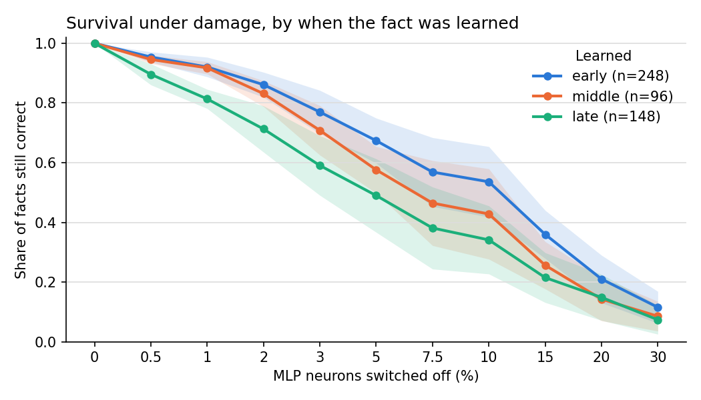
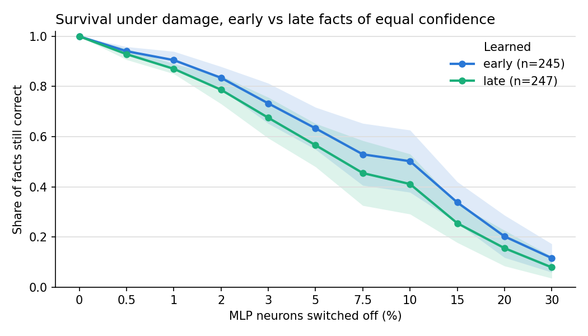

# ribot-in-silico

**Does a language model forget its newest memories first?**

In Alzheimer's disease, recent memories are usually lost before old ones. This pattern is known as Ribot's law. This project asks whether something similar happens in a language model that is damaged little by little: do the facts it learned early in training survive more damage than the facts it learned late?

This is not medical research. The disease is used as a lens to study how a neural network stores what it knows.

## Result

**Weak evidence for a Ribot-like gradient.** Facts learned earlier survive more damage, and the effect remains after controlling for confidence and margin. It is small, and it does not hold in every robustness check: it is not significant when the analysis is limited to at most 10 facts per answer.

All numbers below come from `notebooks/02_ribot_experiment.ipynb`, run on a Google Colab GPU on November 15, 2026.

- Model: EleutherAI/pythia-160m. Facts in the exam: 21913. Known by the final model: 492 (2.2%).
- Snapshots used to date each fact: 15. Facts lost and learned again at least once during training: 69%.
- Damage: 10 nested levels from 0.5% to 30% of 36864 MLP neurons, 10 random draws.
- Age vs resistance (Spearman): rho = -0.299, 95% CI [-0.382, -0.207], p = 1.2e-11.
- Controlled for confidence (partial Spearman): rho = -0.229, p = 0.0002.
- Controlled for confidence and margin: rho = -0.152, p = 0.0004.
- Same, with at most 10 facts per answer (n = 265): rho = -0.090, p = 0.14.
- Confidence-matched gap in resistance, early minus late: +0.055, p = 0.001.
- The confound: age vs confidence rho = -0.234; confidence vs resistance rho = +0.408; margin vs resistance rho = +0.714.

A negative rho means that facts learned earlier resist more. Margin alone predicts resistance far better than age does.

*Figure 1. Share of known facts still answered correctly as more neurons are switched off, by when the fact was learned. Bands show the spread across 10 random draws. This figure does not control for confidence.*

*Figure 2. The same comparison between early and late facts matched on confidence. The gap is smaller and still present.*

## Write-ups

- [Paper-style report (PDF)](Ribot%20in%20Silico%20-%20Paper.pdf)
- [Plain-language explainer (PDF)](Ribot%20in%20Silico%20-%20Explained.pdf)

## Method

The experiment uses [Pythia-160M](https://huggingface.co/EleutherAI/pythia-160m), a 12-layer language model released by EleutherAI together with 154 snapshots saved during its training. Those snapshots make it possible to tell when the model learned each fact.

1. **The exam.** All facts in the CounterFact dataset (about 22,000 prompts with a short answer) are given to the fully trained model. A fact counts as known when the first token of the correct answer is the model's top prediction. Only known facts stay in the study.
2. **The age of each memory.** The same exam is given to 15 training snapshots, from step 0 to step 143,000. The age of a fact (`age_first`) is the first snapshot at which the model gets it right.
3. **The damage.** Random MLP neurons of the final model are switched off by forcing their output to zero, in 10 nested levels from 0.5% to 30% of all neurons, repeated with 10 random draws. The resistance of a fact is the share of those 100 damage trials in which the model still gets it right.
4. **The verdict.** Age is compared against resistance with a Spearman rank correlation. A negative correlation means that facts learned earlier resist more.

### The confound and the controls

Facts learned early also tend to be facts the model holds more firmly, and a firmly held fact can resist damage for that reason alone. Three things are done about it.

- **Partial correlation.** The correlation of age with resistance is recomputed after removing what the healthy model's confidence (probability of the correct token) and margin (score gap to the closest competitor) explain in both. The conclusion is based on this strictest version.
- **Matched comparison.** Facts are split into five groups of similar confidence. Inside each group they are split in half by age, and the early and late halves are compared.
- **Answer cap.** A few answers are very common among the known facts. The analysis is repeated with at most 10 facts per answer.

The rule that turns these numbers into a conclusion is written in the notebook. It was set after a test run and before the official run. The only change made after the test was to make it stricter: the margin control and the two robustness requirements were added.

### Choices worth knowing about

- Facts are not learned once and for all. Many are answered correctly at one snapshot, incorrectly at the next, and correctly again later. A stricter definition of age (`age_stable`, the first snapshot from which the fact stays correct) is reported as a robustness check only: a fact that keeps failing at some snapshots is a fragile fact, so that definition partly measures fragility itself.
- Damage is not monotonic for individual facts. A fact can fail at one damage level and come back at a higher one. This is why resistance is the share of trials survived and not the first level of failure. The first-failure measure is reported as a robustness check.

## Limitations

- One model family and one model size. Pythia-160M knows only a small share of CounterFact under a strict rule, so the study runs on a few hundred facts.
- One kind of damage: random zero-ablation of MLP neurons. Attention heads, weights and targeted damage are not tested.
- The known facts are concentrated in a few answers and relations. Some may be answered from surface patterns in the subject's name and not from a stored fact.
- Age depends on which snapshots are sampled. With 15 snapshots, facts learned between two snapshots get the same age.
- Confidence and margin are measured at the end of training. If learning a fact early is what makes the model hold it firmly, controlling for them removes part of a real effect. The controlled result is a conservative estimate.
- How often each fact appears in the training data is not measured. Confidence is used as a stand-in.
- The result is a correlation in one trained model. It does not show why early facts would be more robust.

## Reproduce

Open `notebooks/02_ribot_experiment.ipynb` in Google Colab, select a T4 GPU runtime and choose `Runtime > Run all`. It takes about 10 minutes and writes every table and figure to `results/`.

| Path | Contents |
|---|---|
| `notebooks/01_hello_pythia.ipynb` | Smoke test: load the model, score one fact, load earlier snapshots |
| `notebooks/02_ribot_experiment.ipynb` | The full experiment: exam, age, damage and verdict |
| `results/pythia-160m/` | Output of notebook 02: tables, figures and the result text |

## Related work

The idea that what is learned early is more robust is not new. What this project adds is a per-fact test in a pretrained transformer language model, using the natural order of training and a control for how firmly each fact is held.

- Ellis and Lambon Ralph (2000), Age of acquisition effects in adult lexical processing reflect loss of plasticity in maturing systems: insights from connectionist networks. *Journal of Experimental Psychology: Learning, Memory, and Cognition*, 26(5), 1103-1123.
- Sohrabi (2019), [Age of Acquisition Effect: Evidence From Single-Word Reading and Neural Networks](https://pmc.ncbi.nlm.nih.gov/articles/PMC6484193/). Lesions a small word-reading network and reports fewer errors on early-learned words.
- Toneva et al. (2018), [An Empirical Study of Example Forgetting during Deep Neural Network Learning](https://arxiv.org/abs/1812.05159). Some training examples are forgotten repeatedly during training and others never.
- Hooker et al. (2019), [What Do Compressed Deep Neural Networks Forget?](https://arxiv.org/abs/1911.05248). Pruning hurts atypical, long-tail examples the most.
- Baldock, Maennel and Neyshabur (2021), [Deep Learning Through the Lens of Example Difficulty](https://arxiv.org/abs/2106.09647). Relates example difficulty to confidence and speed of learning.
- Chang, Tu and Bergen (2024), [Characterizing Learning Curves During Language Model Pre-Training: Learning, Forgetting, and Stability](https://arxiv.org/abs/2308.15419).
- Li, Sheng, Cohen and Pakhomov (2024), [Too Big to Fail: Larger Language Models are Disproportionately Resilient to Induction of Dementia-Related Linguistic Anomalies](https://aclanthology.org/2024.findings-acl.380).
- Alexos et al. (2024), [Neural Erosion: Emulating Controlled Neurodegeneration and Aging in AI Systems](https://arxiv.org/abs/2403.10596).
- Biderman et al. (2023), [Pythia: A Suite for Analyzing Large Language Models Across Training and Scaling](https://proceedings.mlr.press/v202/biderman23a/biderman23a.pdf). The models and training snapshots used here.
- Meng et al. (2022), [Locating and Editing Factual Associations in GPT](https://arxiv.org/abs/2202.05262). The CounterFact dataset.

This is a starting list, not a complete review.

## Data and licenses

- Pythia models: Apache 2.0, EleutherAI.
- CounterFact: from the [ROME project](https://github.com/kmeng01/rome) (MIT license). The dataset is downloaded at run time from its original source and is not redistributed in this repository.
- Code in this repository: MIT.

## AI assistance

This project was built with the help of Claude (Anthropic), used for experiment design discussion, code drafting and review. All results come from notebooks run by the author.

## Author

Jimmy Carranza
